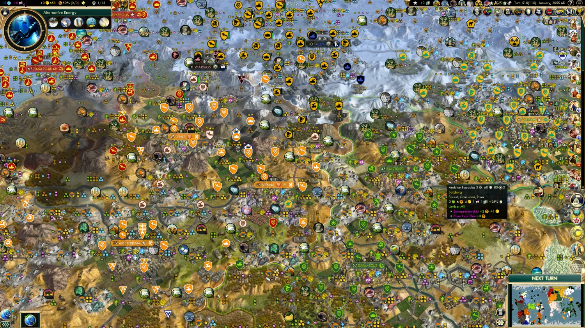

# Civ V Crash Patch



Fixes crashes in big games of **Sid Meier's Civilization V**: Huge maps, many civs, big mods like
Vox Populi, and long late games. It also frees memory the game wastes and shortens late-game AI
turns.

It's one file, `msimg32.dll`, in the game folder. It works with or without mods and doesn't change
game rules or saves.

Tested on a late-game Vox Populi + EUI game on a Huge map, and on the unmodded game. Please
[report how it goes](https://github.com/PureXYZ/civ5-crash-patch/issues), good or bad.

## Install

Requires the Windows Steam version of Civ V, version 1.0.3.279 (the final update).

1. Download `CivVCrashPatch-1.4.0.zip` from the
   [latest release](https://github.com/PureXYZ/civ5-crash-patch/releases/latest) (under *Assets*).
2. Unzip it: right-click the zip, choose **Extract All…**, then **Extract**.
3. Open the game folder: in your Steam **Library**, right-click **Sid Meier's Civilization V** and
   choose **Manage → Browse local files**. The folder that opens contains `CivilizationV_DX11.exe`.
4. Copy `msimg32.dll` into the game folder. Don't rename it. If Windows asks for permission, click
   **Continue**.
5. Start the game. When Steam asks how to launch it, choose **DirectX 11**.

You don't need the settings file in the zip's `optional` folder. It's only for changing settings
([Settings](docs/SETTINGS.md)).

### Check that it's working

Start the game. A `civprobe` folder appears in the game folder. Open the newest `events_….log` in
it with Notepad. The first line should contain `Civ V Crash Patch 1.4.0`.

### Update or uninstall

To update, close the game and copy the new `msimg32.dll` over the old one. Then start the game and
check the newest log's first line for the new version.

To uninstall, delete `msimg32.dll` (and `civprobe.ini` and the `civprobe` folder, if you like).
Nothing else was changed. Steam's *Verify integrity of game files* doesn't remove extra files, so
delete it yourself.

## What it fixes

Civ V is a 32-bit program, so it can use only about 4 GB of memory, however much RAM you have. Big
games get close to that, and a few game bugs waste or corrupt memory under load. That causes the
random crashes.

### Crashes

- Busy turns (the main crash). With many units on the map, a list in the graphics code overflowed
  into nearby memory, often the sound system's. That's why these crashes were blamed on `mss32.dll`.
- Loading a big save. Loading posted more events than the game's event list could hold.
- Quitting to the desktop. The crash report on exit is gone. Saves were never affected.

### Memory

- Long sessions. Memory filled with small gaps the game couldn't reuse, until it crashed after an
  hour or so. A better memory manager fixes this.
- Mods. Mods query the game's database often, and the leftovers piled up: up to 420 MB while
  starting a new Huge game. They're now cleaned up as you play.
- Wasted memory. The game reserves room for the largest possible map, gives the fog of war 24 MB
  per job thread that it barely uses, and keeps script and database memory in heaps that never
  shrink. The patch frees about 100 MB on a Huge map, plus about 90 MB of fog buffers with 4 job
  threads.
- Intro movie. Its player loads about 75 MB of video and Direct3D 9 drivers that stay loaded all
  session, so the patch skips it. The opening movie and the Firaxis and 2K logos no longer play.
  `SkipIntroPlayer=0` brings them back ([Settings](docs/SETTINGS.md#memory-savings-on-by-default)).

The 4 GB limit can't be raised, so a very large late game can still fill it. When less than 200 MB
is left, the game shows a warning at the top of the screen. Save, quit to the desktop and load the
save again ([more](docs/TROUBLESHOOTING.md#the-game-says-it-is-running-out-of-memory)).

### AI turns

- Faster AI turns. Most of a late-game AI turn was the game waiting on itself, not the AI thinking.
  In testing, AI turns dropped from about 65-70 s to 45-50 s.
- Smoother scrolling. Some panels, and mods like Global Relations, redrew every time the AI changed
  something, so the map stuttered or froze while you scrolled. Redraws close together are now
  merged into one.

### Graphics (DirectX 11 only)

- Black or magenta icons and city banners ("Error loading font texture"). The game holds at most
  12,288 textures and keeps nearly all it loads, so big mod sets fill it. The patch raises the
  limit to 16,384.
- Grey terrain when scrolling. The game kept terrain textures for under a third of a Huge map and
  rebuilt the rest from grey as you scrolled. Each map now gets enough for all its tiles. This
  costs about 40-110 MB of memory space on a Huge map, 14 MB on smaller maps.

Everything else works in DirectX 11, DirectX 9 and tablet mode, except the smaller fog buffers
(DirectX 11 only).

## Game settings for big games

- Use DirectX 11. DirectX 9 keeps a second copy of textures and models in memory (about 500 MB on a
  Huge late-game save), and the graphics fixes need DirectX 11.
- Leave **GPU Texture Decode** on (Options → Video Options; on by default). With it off, the game
  keeps leader textures in its own memory instead of on the graphics card: about 150 MB with 17
  leaders. Some guides say to turn it off to fix black icons. With the patch, that isn't needed
  ([details](docs/TROUBLESHOOTING.md#keep-gpu-texture-decode-on)).

More in [Troubleshooting and tips](docs/TROUBLESHOOTING.md).

## Questions

**Is it safe?** The source code is in this repository. Release DLLs are built from it on GitHub's
servers, not on anyone's PC ([see the builds](https://github.com/PureXYZ/civ5-crash-patch/actions)).
Each release lists the file's SHA-256 checksum.

**My antivirus flagged it.** Antivirus heuristics sometimes flag small unsigned DLLs that load into
games, and code signing costs money. Compare the file's checksum with the one on the release page,
or [build it yourself](#build-from-source).

**Does it work with Vox Populi, EUI and other mods?** Yes. It was developed on a Vox Populi + EUI
game.

**Saves and multiplayer?** It doesn't touch game rules or save files, and saves still load without
it. Multiplayer is untested.

**Other game versions?** Fixes that patch specific spots in the game check them first. On versions
other than 1.0.3.279 they turn off and say so in the log, and the game runs as it would without
them.

**Steam Deck or Linux (Proton)?** Untested. To make Proton load the DLL, add
`WINEDLLOVERRIDES="msimg32=n,b" %command%` to the game's launch options.

**Mac?** No. The Mac version is a different program.

**The game still crashed.** Please report it.
[Reporting a crash](docs/TROUBLESHOOTING.md#reporting-a-crash) lists the two files to attach.

## Documentation

- [Troubleshooting and tips](docs/TROUBLESHOOTING.md): problems, big-game tips, reporting a crash
- [Settings](docs/SETTINGS.md): change or turn off parts of the patch
- [How it works](docs/HOW-IT-WORKS.md): the game's bugs and how the patch fixes them
- [Research notes](docs/RESEARCH-NOTES.md): the full investigation, dead ends included
- [Developer guide](probe/README.md): building, tests, diagnostic tools
- [Changelog](CHANGELOG.md): changes in each version

## Technical details

The patch is a proxy `msimg32.dll`. The exe imports msimg32, so the copy in the game folder loads
first and forwards the real exports to the system DLL.

The main crash was a render command stream (`core\CommandStream.cpp`) with no capacity checks. On a
Huge map with about 1,700 units, busy frames needed up to ~5,700 of its 4,096 command slots. The
overflow landed in the Miles audio engine's sample table, so render data was used as sound handles.
The patch gives the stream spare room and bounds every writer.

The other fixes hook imports, write game data or change code, each after checking the bytes it
relies on. None touches the game's main loop, and newer code changes avoid the code Steam's copy
protection checksums. See [How it works](docs/HOW-IT-WORKS.md#loading-and-safety-checks).

### Build from source

Requires [LLVM-MinGW](https://github.com/mstorsjo/llvm-mingw)
(`winget install MartinStorsjo.LLVM-MinGW.UCRT`) and a POSIX shell such as Git Bash.

```bash
sh probe/build.sh
```

Output: `probe/build/msimg32.dll`. Releases are built by
[`.github/workflows/build.yml`](.github/workflows/build.yml).

## License

MIT ([LICENSE](LICENSE)). Includes [mimalloc](https://github.com/microsoft/mimalloc) (MIT, see
[THIRD-PARTY-NOTICES.md](THIRD-PARTY-NOTICES.md)).

Sid Meier's Civilization and Civ are trademarks of Take-Two Interactive Software, Inc. This project
is not affiliated with or endorsed by Firaxis Games, 2K or Take-Two Interactive.
